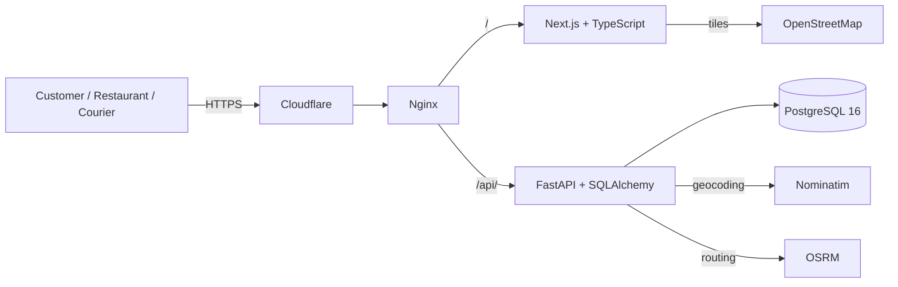

# App de Entrega — Delivery Platform for the Combina Açaí Base Company

[](https://github.com/jorgecarneirojr/App-de-entrega/actions/workflows/ci.yml)
[](LICENSE)
[](https://www.python.org/)
[](https://nodejs.org/)
[](https://p2.carneirojunior.com.br/docs)
[](https://www.youtube.com/watch?v=ZHFJPzqw1f0)

> Read this in Portuguese: [README.md](README.md)

Web delivery platform developed as the **Integrated Project in Computing II (PJI240)** at
**UNIVESP — Lorena/SP, Brazil**, applied to **Combina Açaí**, the same base company from
Integrated Project I.

Project I delivered a CRM for internal customer, sales, product, payment and inventory management.
Project II complements that digital transformation with the external ordering channel: digital
menu, cart, checkout with a real address, route map with distance and time, restaurant order
management and a courier dashboard.

## Live application

- **App:** https://p2.carneirojunior.com.br
- **API docs:** https://p2.carneirojunior.com.br/docs
- **Presentation video:** https://www.youtube.com/watch?v=ZHFJPzqw1f0
- **Repository:** https://github.com/jorgecarneirojr/App-de-entrega

## Features

- JWT authentication and role-based access (`customer`, `restaurant`, `courier`, `admin`).
- Restaurant catalog and digital menu, including the base company menu reproduced from its
  public digital menu (33 items across 7 categories).
- Persistent cart and checkout with a real address.
- Address geocoding and route map with distance/time (OpenStreetMap, Nominatim, OSRM).
- Customer order history.
- Restaurant panel: onboarding, product CRUD, order status and courier assignment.
- Courier panel: active deliveries, status updates and location tracking.
- Seeded demo data for evaluation.

## Architecture



See [`docs/architecture.md`](docs/architecture.md) for components, flows and trade-offs.

## Stack

| Layer | Technologies |
| --- | --- |
| Front-end | Next.js 14, React 18, TypeScript, Tailwind CSS, React Query, Zustand |
| Back-end | FastAPI, SQLAlchemy, Pydantic, Alembic |
| Security | JWT (HS256), bcrypt, RBAC |
| Database | PostgreSQL 16 |
| Geolocation | Leaflet, OpenStreetMap, Nominatim, OSRM |
| Infrastructure | Docker Compose, Nginx, Cloudflare, Let's Encrypt |
| Quality | unittest, Ruff, TypeScript, GitHub Actions |

## Quick start

```bash
cp .env.deploy.example .env
docker compose up -d --build
```

- Front-end: http://localhost:3000
- API: http://localhost:8000
- Swagger: http://localhost:8000/docs

Demo accounts (password `123456`):

| Role | E-mail |
| --- | --- |
| Customer | `client@demo.com` |
| Restaurant (base company) | `owner@demo.com` |
| Restaurant | `massa@demo.com` |
| Courier | `courier@demo.com` |

## Quality

- 9 API tests with `unittest`.
- Backend lint with Ruff.
- Front-end typecheck, production build and smoke test.
- CI on every push and pull request.
- Automated accessibility audit with axe-core (WCAG 2 A/AA) with no violations in the evaluated
  screens.
- Responsive layout verified at 390 px.

## Documentation

| Document | Content |
| --- | --- |
| [`docs/architecture.md`](docs/architecture.md) | Architecture and flows |
| [`docs/data-model.md`](docs/data-model.md) | Relational model and data dictionary |
| [`docs/api-contract.md`](docs/api-contract.md) | API contract and examples |
| [`docs/testing.md`](docs/testing.md) | Test strategy and matrix |
| [`docs/accessibility.md`](docs/accessibility.md) | WCAG checklist and audit |
| [`docs/security.md`](docs/security.md) | Security, privacy and LGPD |
| [`docs/deploy.md`](docs/deploy.md) | Local and cloud deployment |
| [`docs/academic.md`](docs/academic.md) | Academic context and methodology |
| [`docs/adr/`](docs/adr/) | Architecture Decision Records |

## Academic context

- **Course:** Computing — UNIVESP
- **Discipline:** PJI240 — Integrated Project in Computing II
- **Advisor:** Prof. Lucas Secarelli Laureano Tostes
- **Base company:** Combina Açaí — Lorena/SP, Brazil

The project is applied research with a qualitative approach, conducted as a case study and
structured by Human-Centered Design and Design Thinking.

## Citation

See [`CITATION.cff`](CITATION.cff).

## License

MIT — see [`LICENSE`](LICENSE).
