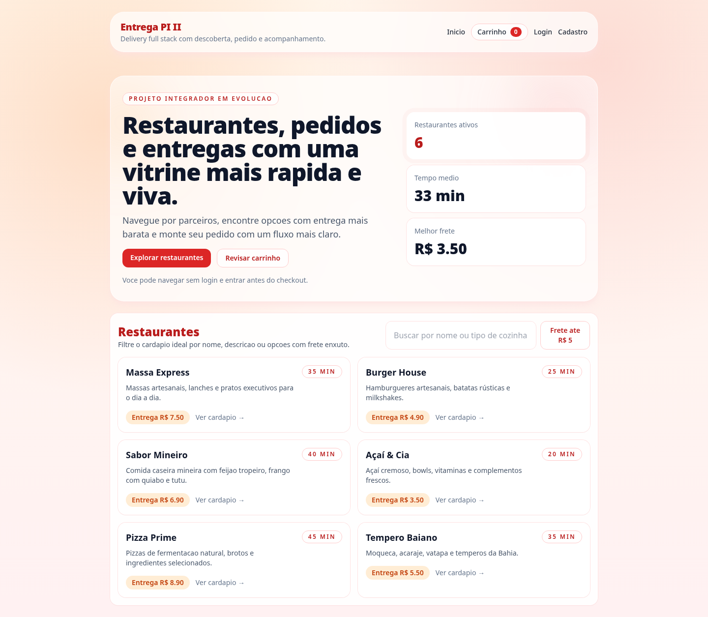
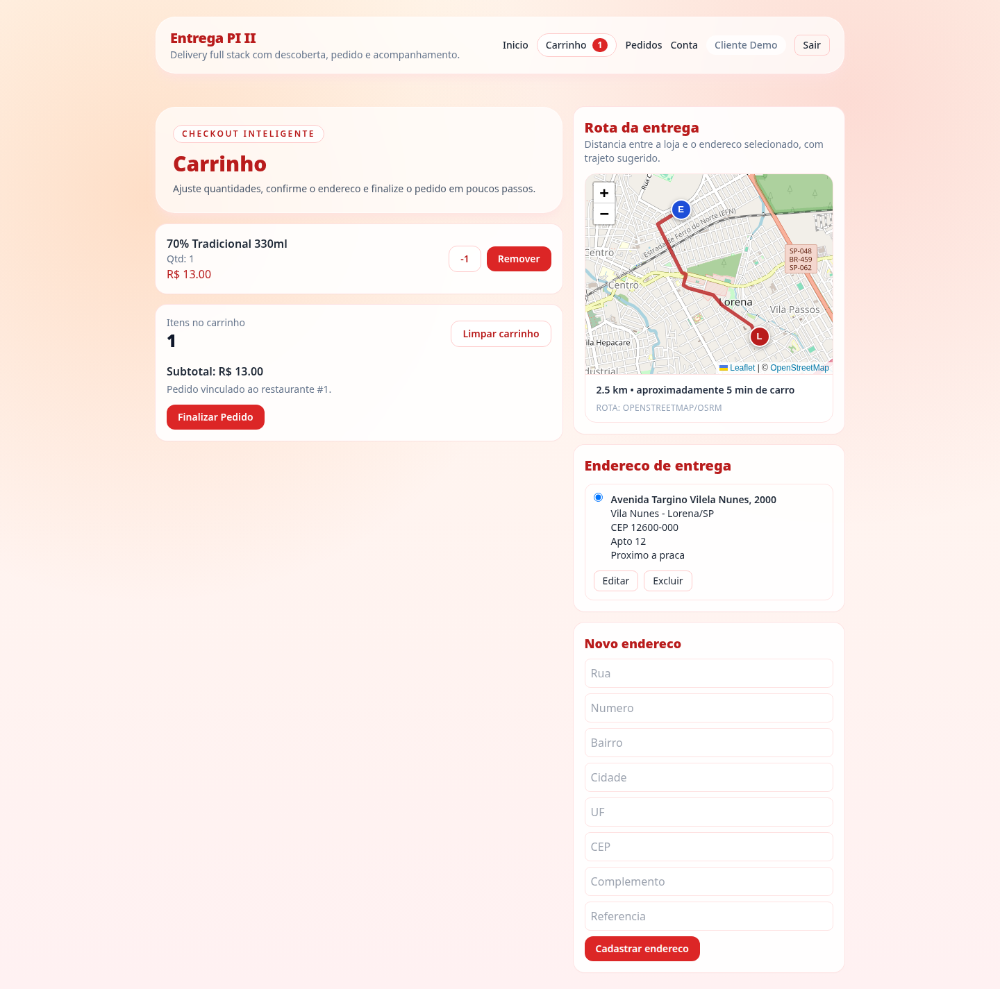
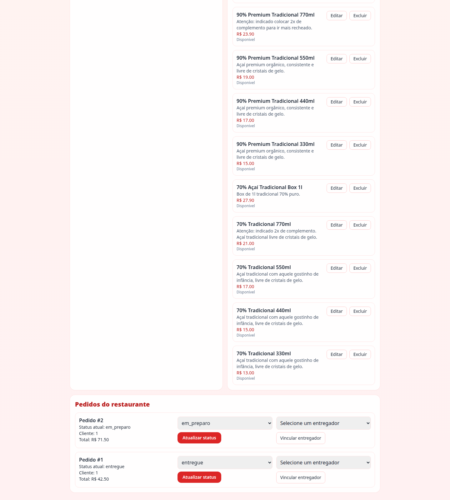
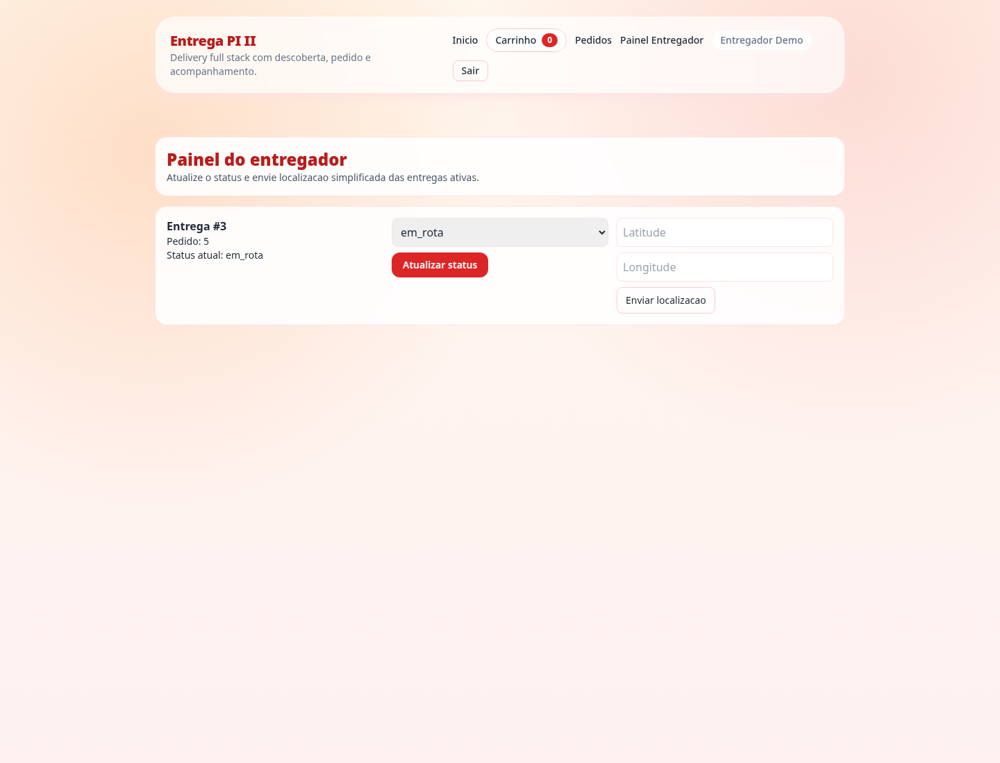
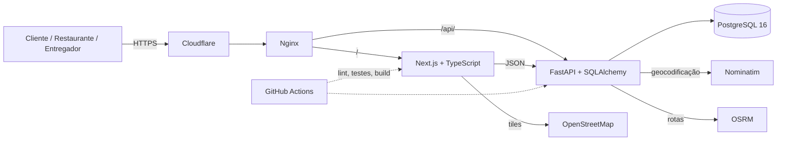
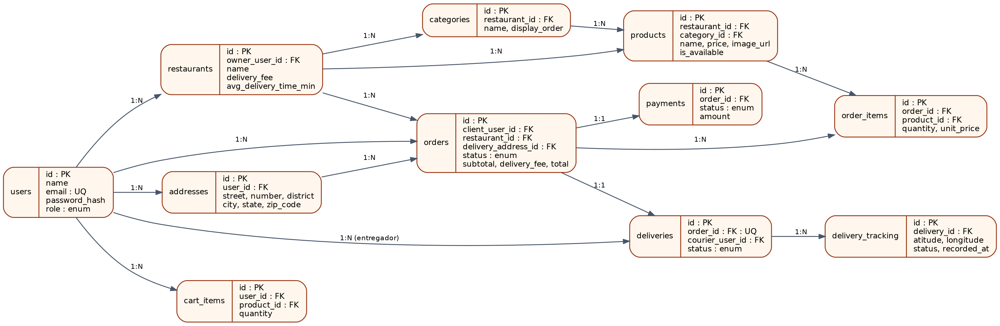

# App de Entrega — Plataforma de Delivery para a Empresa Base Combina Açaí

[](https://github.com/jorgecarneirojr/App-de-entrega/actions/workflows/ci.yml)
[](LICENSE)
[](https://www.python.org/)
[](https://nodejs.org/)
[](https://p2.carneirojunior.com.br/docs)
[](https://www.univesp.br/)
[](https://www.youtube.com/watch?v=ZHFJPzqw1f0)

> Leia em inglês: [README.en.md](README.en.md)

Plataforma web de delivery desenvolvida como **Projeto Integrador em Computação II (PJI240)** da
**UNIVESP — Polo Lorena/SP**, aplicada à **açaiteria Combina Açaí**, a mesma empresa base do
Projeto Integrador I.

O PI1 entregou um CRM para a gestão interna de clientes, vendas, produtos, pagamentos e estoque.
O PI2 complementa essa transformação digital com o canal externo de pedidos: cardápio digital,
carrinho, checkout com endereço real, mapa de rota com distância e tempo, gestão de pedidos pelo
restaurante e painel do entregador.

> **Aplicação publicada:** https://p2.carneirojunior.com.br  
> **Documentação da API:** https://p2.carneirojunior.com.br/docs  
> **Vídeo de apresentação:** https://www.youtube.com/watch?v=ZHFJPzqw1f0  
> **Repositório:** https://github.com/jorgecarneirojr/App-de-entrega

---

## Sumário

- [Visão geral](#visão-geral)
- [Funcionalidades](#funcionalidades)
- [Capturas de tela](#capturas-de-tela)
- [Arquitetura](#arquitetura)
- [Stack tecnológica](#stack-tecnológica)
- [Modelo de dados](#modelo-de-dados)
- [API](#api)
- [Acessibilidade](#acessibilidade)
- [Qualidade e testes](#qualidade-e-testes)
- [Segurança e privacidade](#segurança-e-privacidade)
- [Execução local](#execução-local)
- [Deploy](#deploy)
- [Estrutura do repositório](#estrutura-do-repositório)
- [Documentação](#documentação)
- [Contexto acadêmico](#contexto-acadêmico)
- [Roadmap](#roadmap)
- [Como citar](#como-citar)
- [Licença](#licença)

---

## Visão geral

O problema identificado em campo é a dependência de pedidos por telefone e WhatsApp, sem registro
consolidado, sem cardápio digital próprio e sujeita às comissões de plataformas agregadoras. A
solução digitaliza o fluxo completo — do catálogo à entrega — e foi concebida para ser operada
pela própria empresa, com custo compatível com o porte de uma microempresa.

A plataforma possui quatro perfis:

| Perfil | Responsabilidades |
| --- | --- |
| **Cliente** | Consultar restaurantes e cardápios, montar o carrinho, cadastrar endereços, visualizar a rota e acompanhar pedidos. |
| **Restaurante** | Realizar onboarding, gerenciar produtos, acompanhar pedidos e vincular entregadores. |
| **Entregador** | Visualizar entregas ativas, atualizar o status e registrar a localização. |
| **Administrador** | Acesso administrativo aos recursos protegidos por perfil. |

### Contas de demonstração

A base de demonstração é populada automaticamente com seis restaurantes, cardápios, endereço,
pedidos em diferentes estados e entregas. Todas as senhas são `123456`.

| Perfil | E-mail | Uso principal |
| --- | --- | --- |
| Cliente | `client@demo.com` | Vitrine, carrinho, checkout, rota e histórico |
| Restaurante | `owner@demo.com` | Massa Express |
| Restaurante | `burger@demo.com` | Burger House |
| Restaurante | `mineiro@demo.com` | Sabor Mineiro |
| Restaurante | `acai@demo.com` | Açaí & Cia |
| Restaurante | `pizza@demo.com` | Pizza Prime |
| Restaurante | `baiano@demo.com` | Tempero Baiano |
| Entregador | `courier@demo.com` | Entrega ativa em rota |
| Entregador | `courier2@demo.com` | Entregador reserva |

> Credenciais exclusivas para demonstração. Não utilize em produção.

---

## Funcionalidades

### Cliente
- Cadastro, login e sessão com JWT.
- Vitrine de restaurantes com busca e filtro por frete.
- Cardápio digital por restaurante.
- Carrinho persistido no navegador.
- CRUD de endereços com geocodificação automática.
- Checkout com endereço real e cálculo de rota.
- Mapa com marcadores da loja e do endereço, traçado, distância e tempo.
- Histórico de pedidos com status.

### Restaurante
- Onboarding com endereço e geocodificação.
- CRUD de produtos com disponibilidade.
- Painel de pedidos e atualização de status.
- Vinculação de entregador por pedido.

### Entregador
- Lista de entregas ativas.
- Atualização de status da entrega.
- Registro de latitude/longitude com validação de limites.

### Plataforma
- API REST documentada em OpenAPI.
- Migrations versionadas com Alembic.
- Dados de demonstração idempotentes.
- Conteinerização com Docker Compose.
- CI com lint, testes, typecheck, build e smoke test.

---

## Capturas de tela

| Vitrine | Checkout com rota |
| --- | --- |
|  |  |

| Painel do restaurante | Painel do entregador |
| --- | --- |
|  |  |

---

## Arquitetura

A aplicação segue o estilo cliente-servidor em três camadas, com o front-end e a API atrás do
Nginx e o banco isolado na rede interna do Docker. O acesso público ocorre por HTTPS, com
Cloudflare e certificado Let's Encrypt.



Decisões arquiteturais, fluxos e responsabilidades estão em
[`docs/architecture.md`](docs/architecture.md). As decisões registradas no formato ADR estão em
[`docs/adr/`](docs/adr/).

---

## Stack tecnológica

| Camada | Tecnologias | Função |
| --- | --- | --- |
| Front-end | Next.js 14, React 18, TypeScript, Tailwind CSS, React Query, Zustand | Interface, estado e consumo da API |
| Back-end | FastAPI, SQLAlchemy, Pydantic, Alembic | API REST, validação, ORM e migrations |
| Segurança | JWT (HS256), bcrypt | Autenticação, hash de senhas e RBAC |
| Banco | PostgreSQL 16 | Persistência relacional e integridade |
| Geolocalização | Leaflet, OpenStreetMap, Nominatim, OSRM | Mapa, geocodificação e rotas |
| Infraestrutura | Docker Compose, Nginx, Cloudflare, Let's Encrypt | Conteinerização, proxy, HTTPS |
| Qualidade | unittest, Ruff, TypeScript, GitHub Actions | Testes, lint, typecheck e CI |

---

## Modelo de dados

O modelo relacional possui onze tabelas: `users`, `addresses`, `restaurants`, `categories`,
`products`, `orders`, `order_items`, `payments`, `cart_items`, `deliveries` e
`delivery_tracking`. As relações preservam integridade referencial entre clientes, restaurantes,
produtos, pedidos e entregas.

O diagrama e o dicionário de dados estão em [`docs/data-model.md`](docs/data-model.md).



---

## API

A API segue o estilo REST, com versionamento em `/api/v1`, autenticação por Bearer token e
documentação interativa gerada pelo FastAPI.

- **Swagger UI:** https://p2.carneirojunior.com.br/docs
- **OpenAPI JSON:** https://p2.carneirojunior.com.br/openapi.json
- **Contrato resumido:** [`docs/api-contract.md`](docs/api-contract.md)

### Autenticação

```http
POST /api/v1/auth/login
Content-Type: application/json

{
  "email": "client@demo.com",
  "password": "123456"
}
```

A resposta contém `access_token`, que deve ser enviado como `Authorization: Bearer <token>`.

### Endpoints principais

| Grupo | Métodos |
| --- | --- |
| Autenticação | `POST /auth/register`, `POST /auth/login`, `GET /auth/me` |
| Endereços | `GET/POST /addresses`, `PUT/DELETE /addresses/{id}` |
| Restaurantes | `GET /restaurants`, `GET /restaurants/mine`, `POST /restaurants`, `GET /restaurants/{id}/menu` |
| Produtos | `GET /products/restaurant/{id}`, `POST /products`, `PUT/DELETE /products/{id}` |
| Pedidos | `POST /orders`, `GET /orders/me`, `PATCH /orders/{id}/status`, `PATCH /orders/{id}/assign-courier` |
| Entregas | `PATCH /deliveries/{id}/status`, `POST /deliveries/{id}/location`, `GET /deliveries/me/active` |
| Geolocalização | `GET /geo/geocode`, `GET /geo/route` |

Os prefixos `/api/v1` foram omitidos na tabela. Erros seguem o padrão do FastAPI
(`detail`), com `401` para token inválido, `403` para perfil sem permissão, `404` para recurso
inexistente e `422` para validação.

---

## Acessibilidade

A interface foi construída com práticas de acessibilidade e verificada com auditoria automatizada:

- HTML semântico, `lang="pt-BR"` e hierarquia de títulos.
- Atalho “Pular para o conteúdo” e foco visível.
- Rótulos associados aos campos e `aria-label` em controles dinâmicos.
- Mensagens de status com `aria-live`.
- Respeito a `prefers-reduced-motion`.
- Layout responsivo verificado em 390 px, sem rolagem horizontal.
- Auditoria `axe-core` (WCAG 2 A/AA) sem violações nas telas avaliadas.

Detalhes e checklist em [`docs/accessibility.md`](docs/accessibility.md).

> A auditoria automatizada é um indicativo de qualidade; não substitui avaliação manual com
> usuários e especialistas.

---

## Qualidade e testes

| Verificação | Ferramenta | Escopo |
| --- | --- | --- |
| Lint do backend | Ruff | Importação, erros, modernização e boas práticas |
| Testes de API | unittest | 8 cenários de autenticação, pedidos, entregas, coordenadas e rotas |
| Typecheck | TypeScript | Todo o front-end |
| Build | Next.js | Build de produção |
| Smoke test | Script + HTTP | Páginas principais |
| CI | GitHub Actions | Executa todas as verificações a cada push/PR |

```bash
# Backend
cd backend
python -m unittest discover -s tests -v
ruff check app tests

# Frontend
cd frontend
npm run typecheck
npm run build
npm run smoke
```

A matriz completa de testes está em [`docs/testing.md`](docs/testing.md).

---

## Segurança e privacidade

- Senhas armazenadas com bcrypt; nunca em texto puro.
- Autenticação JWT com expiração e verificação de perfil.
- Segregação de acesso por perfil (`cliente`, `dono_restaurante`, `entregador`, `admin`).
- Segredos fora do repositório (`.env` ignorado) e exemplo em `.env.deploy.example`.
- Banco PostgreSQL sem exposição pública; acesso apenas pela rede interna do Docker.
- CORS restrito ao domínio publicado.
- Dados de demonstração fictícios; nenhum dado real de cliente é versionado.
- Backup diário com `pg_dump` e retenção no servidor.
- Chamadas a APIs externas feitas pelo back-end, sem envio de dados pessoais.

Política e limitações em [`SECURITY.md`](SECURITY.md) e [`docs/security.md`](docs/security.md).

---

## Execução local

### Pré-requisitos

- Docker e Docker Compose
- Ou Python 3.11+ e Node.js 20+ para execução manual

### Docker Compose

```bash
cp .env.deploy.example .env
docker compose up -d --build
```

Serviços:

- Front-end: http://localhost:3000
- API: http://localhost:8000
- Swagger: http://localhost:8000/docs
- Nginx: http://localhost

O backend aplica as migrations automaticamente na inicialização. Para popular a base de
demonstração, mantenha `SEED_DEMO_DATA=true`.

### Execução manual

```bash
# Backend
cd backend
cp .env.example .env
pip install -r requirements-dev.txt
alembic upgrade head
uvicorn app.main:app --reload

# Front-end (outro terminal)
cd frontend
cp .env.example .env.local
npm install
npm run dev
```

### Variáveis de ambiente

| Variável | Descrição |
| --- | --- |
| `DATABASE_URL` | URL de conexão do PostgreSQL |
| `SECRET_KEY` | Chave de assinatura dos tokens JWT |
| `ACCESS_TOKEN_EXPIRE_MINUTES` | Tempo de expiração do token |
| `BACKEND_CORS_ORIGINS` | Origens permitidas |
| `SEED_DEMO_DATA` | Popula a base de demonstração |
| `NEXT_PUBLIC_API_BASE_URL` | Base da API consumida pelo front-end |
| `GEOCODING_ENABLED` | Habilita geocodificação automática |

---

## Deploy

O deploy de referência utiliza Oracle Cloud (Ubuntu), Docker Compose, Nginx, Cloudflare e
Let's Encrypt. O passo a passo está em [`docs/deploy.md`](docs/deploy.md) e
[`docs/oracle-deploy.md`](docs/oracle-deploy.md).

Resumo:

```bash
cp .env.deploy.example .env
# editar .env com credenciais fortes
docker compose -f docker-compose.deploy.yml -p pi2 up -d --build
```

O Nginx encaminha `/` para o front-end e `/api/` para a API. O banco não expõe porta no host.
O certificado é renovado pelo Certbot e o backup do banco é executado diariamente.

---

## Estrutura do repositório

```text
App-de-entrega/
├── backend/                 # API FastAPI, modelos, migrations e testes
│   ├── alembic/             # Migrations
│   ├── app/                 # Aplicação (api, core, models, schemas, services)
│   └── tests/               # Testes de API
├── frontend/                # Next.js, componentes, páginas e store
│   ├── app/                 # Rotas do App Router
│   ├── components/          # Componentes reutilizáveis e mapa
│   └── lib/                 # Cliente HTTP e tipos
├── docs/                    # Documentação técnica e acadêmica
│   ├── adr/                 # Architecture Decision Records
│   └── images/              # Diagramas e capturas de tela
├── infra/                   # Nginx e backup
├── .github/                 # CI e templates
├── docker-compose.yml       # Ambiente local
├── docker-compose.deploy.yml# Ambiente publicado
└── README.md
```

---

## Documentação

| Documento | Conteúdo |
| --- | --- |
| [`docs/architecture.md`](docs/architecture.md) | Arquitetura, fluxos e decisões |
| [`docs/data-model.md`](docs/data-model.md) | Modelo relacional e dicionário de dados |
| [`docs/api-contract.md`](docs/api-contract.md) | Contrato resumido da API |
| [`docs/requirements.md`](docs/requirements.md) | Requisitos funcionais e não funcionais |
| [`docs/testing.md`](docs/testing.md) | Estratégia e matriz de testes |
| [`docs/accessibility.md`](docs/accessibility.md) | Checklist WCAG e auditoria |
| [`docs/security.md`](docs/security.md) | Segurança, privacidade e LGPD |
| [`docs/deploy.md`](docs/deploy.md) | Deploy local e em nuvem |
| [`docs/academic.md`](docs/academic.md) | Contexto acadêmico e metodologia |
| [`docs/adr/`](docs/adr/) | Decisões arquiteturais |
| [`CONTRIBUTING.md`](CONTRIBUTING.md) | Como contribuir |
| [`CHANGELOG.md`](CHANGELOG.md) | Histórico de versões |
| [`SECURITY.md`](SECURITY.md) | Política de segurança |

---

## Contexto acadêmico

- **Disciplina:** PJI240 — Projeto Integrador em Computação II
- **Curso:** Eixo da Computação — UNIVESP
- **Polo:** Lorena/SP
- **Orientador:** Prof. Lucas Secarelli Laureano Tostes
- **Empresa base:** Açaiteria Combina Açaí — Lorena/SP
- **Tema norteador:** tecnologia aplicada à digitalização e à melhoria de processos em micro e
  pequenas empresas do setor de alimentação

O projeto é uma pesquisa aplicada, de abordagem qualitativa, conduzida como estudo de caso e
estruturada pelo Design Centrado no Ser Humano (HCD) e pelo Design Thinking. A avaliação inclui
testes automatizados, auditoria de acessibilidade, build de produção e validação funcional com a
empresa base.

Resumo metodológico e resultados em [`docs/academic.md`](docs/academic.md).

---

## Roadmap

- [x] Autenticação e perfis
- [x] Cardápio, carrinho e checkout
- [x] Gestão de produtos e pedidos
- [x] Painel do entregador e localização
- [x] Mapa de rota com distância e tempo
- [x] Acessibilidade e auditoria automatizada
- [x] CI com lint, testes, typecheck e build
- [ ] Integração com gateway de pagamento
- [ ] Notificações automáticas de status
- [ ] Rastreamento em tempo real com mapa
- [ ] Integração com o CRM do PI1
- [ ] Painel de indicadores de vendas

---

## Como citar

Se este projeto contribuir para algum trabalho, utilize o arquivo [`CITATION.cff`](CITATION.cff)
ou a referência abaixo:

```bibtex
@software{app_entrega_pi2_2026,
  author  = {Pereira, Gabriel de Almeida Santos Arantes and
             Carneiro Junior, Jorge Luis and
             Costa, Luiz Guilherme Mariano da and
             Souza, Marcos Paulo Lemos and
             Geraldes, Marcos Vinicius and
             Salles, Mauro C. Campos and
             Freitas, Thamires Picconetto Silva and
             Franca, Vanessa Cristina Batista Guimaraes},
  title   = {App de Entrega: Plataforma de Delivery para a Empresa Base Combina Açaí},
  year    = {2026},
  url     = {https://github.com/jorgecarneirojr/App-de-entrega},
  license = {MIT}
}
```

---

## Licença

Distribuído sob a licença MIT. Consulte [`LICENSE`](LICENSE).

---

## Autores

Gabriel de Almeida Santos Arantes Pereira · Jorge Luis Carneiro Junior · Luiz Guilherme Mariano da
Costa · Marcos Paulo Lemos Souza · Marcos Vinicius Geraldes · Mauro C. Campos Salles · Thamires
Picconetto Silva Freitas · Vanessa Cristina Batista Guimaraes Franca

**Orientação:** Prof. Lucas Secarelli Laureano Tostes  
**Instituição:** Universidade Virtual do Estado de São Paulo (UNIVESP) — Polo Lorena/SP
