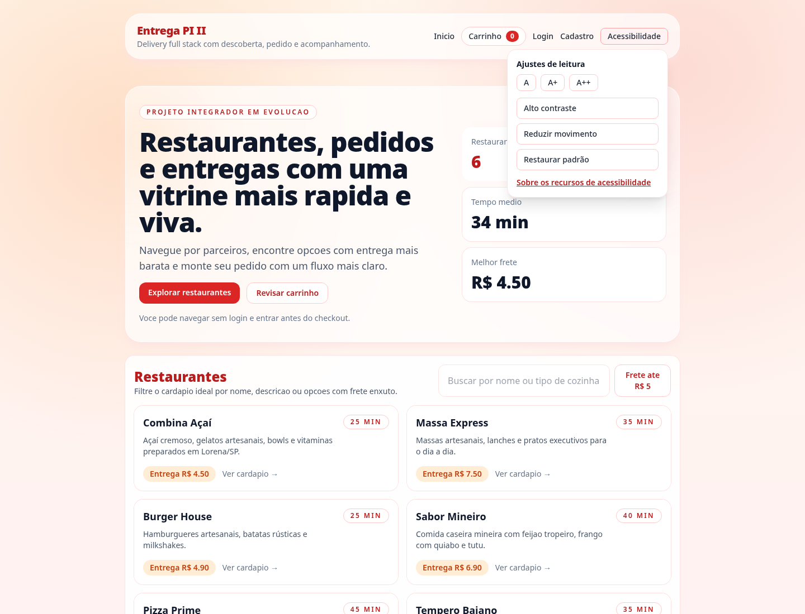
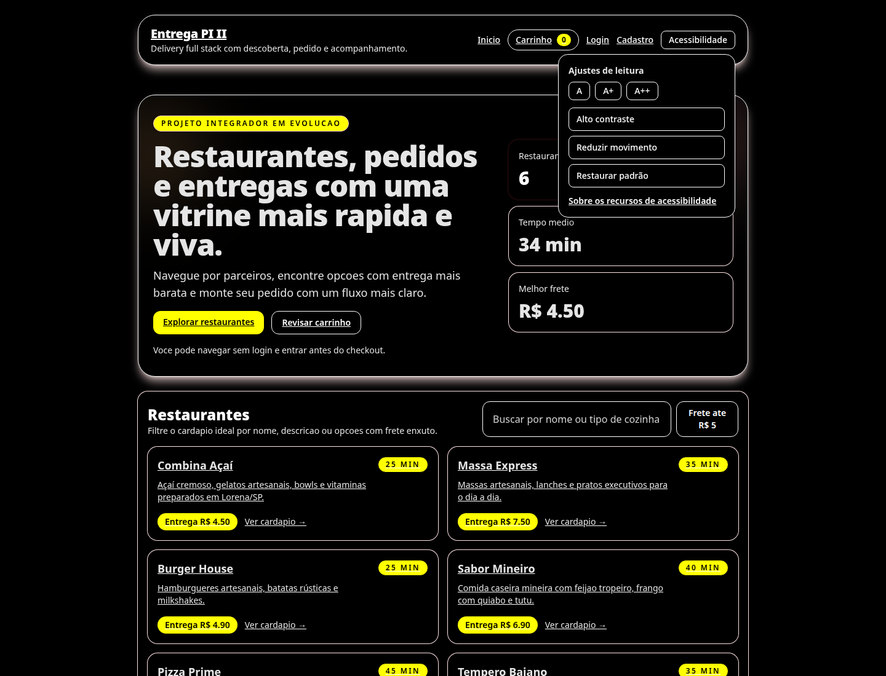

# Acessibilidade

A interface foi projetada para reduzir barreiras de uso e segue boas práticas alinhadas às
diretrizes WCAG 2. O compromisso é com a melhoria contínua, não com uma certificação formal.

## 1. Práticas implementadas

| Critério | Implementação |
| --- | --- |
| Idioma | `<html lang="pt-BR">` |
| Navegação por teclado | Elementos nativos, atalho “Pular para o conteúdo” e foco visível |
| Formulários | Rótulos associados (`label for`), `aria-label` em controles dinâmicos e `autocomplete` |
| Mensagens | Erros e sucessos com `aria-live="polite"` |
| Movimento | Respeito a `prefers-reduced-motion` |
| Contraste | Paleta com contraste adequado para texto e botões |
| Responsividade | Layout adaptável, verificado em 390 px sem rolagem horizontal |
| Semântica | `header`, `nav`, `main`, `section`, `article`, títulos hierárquicos |
| Preferências | Painel com tamanho do texto (A/A+/A++), alto contraste e redução de movimento, persistido no navegador |
| Mudança de rota | Região `aria-live` anuncia a página atual |
| Mapa | Região nomeada, marcadores com título e resumo textual da rota |
| Página dedicada | `/acessibilidade` com recursos, avaliação e limitações |
| Mídia | Sem imagens decorativas no conteúdo principal; ícones acompanhados de texto |

## 2. Auditoria automatizada

O painel de acessibilidade e o modo de alto contraste estão ilustrados abaixo.




Foi utilizada a ferramenta **axe-core** com as regras WCAG 2 níveis A e AA nas telas:

- Vitrine (`/`)
- Login (`/login`)
- Cadastro (`/register`)
- Cardápio (`/restaurants/1`)
- Carrinho (`/cart`)
- Painel do restaurante (`/owner`)
- Painel do entregador (`/courier`)
- Página de acessibilidade (`/acessibilidade`)

**Resultado:** nenhuma violação reportada nas telas avaliadas, incluindo o painel de acessibilidade aberto.

> A auditoria automatizada cobre parte dos critérios. Não substitui testes com leitores de tela
> (NVDA, VoiceOver), navegação apenas por teclado ou avaliação com usuários.

## 3. Checklist manual recomendado

- [ ] Navegar por todas as páginas apenas com `Tab` e `Shift+Tab`.
- [ ] Verificar foco visível em links, botões, campos e selects.
- [ ] Testar leitura com leitor de tela em pelo menos um fluxo completo.
- [ ] Verificar contraste com ferramenta específica.
- [ ] Testar zoom de 200% e largura de 390 px.
- [ ] Confirmar que mensagens de erro são anunciadas.
- [ ] Verificar que o mapa possui alternativa textual (distância e endereço).
- [ ] Testar o painel de acessibilidade: A/A+/A++, alto contraste, redução de movimento e restauração.
- [ ] Confirmar que a mudança de página é anunciada por leitor de tela.

## 4. Limitações conhecidas

- O mapa Leaflet depende de interação visual; a distância e o tempo são exibidos em texto.
- Não há testes automatizados com leitores de tela.
- A validação com usuários foi restrita ao contexto do projeto.

## 5. Como reproduzir a auditoria

```bash
cd frontend
npm install
# com o app em execução:
npx playwright-core ...  # script de auditoria com axe-core
```

O repositório mantém as evidências visuais em [`images/`](images/).
