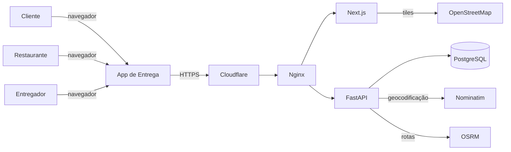
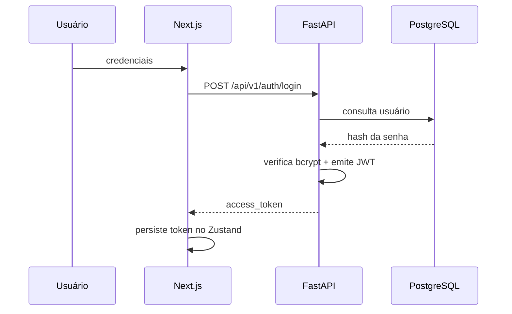
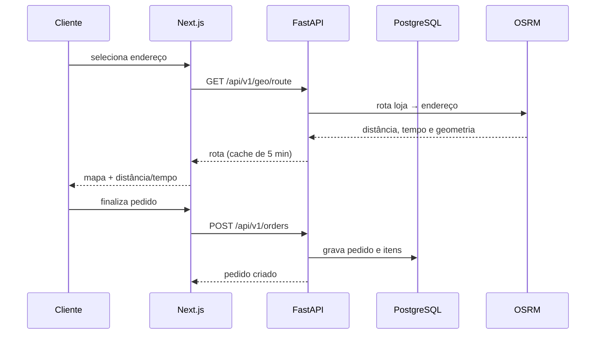
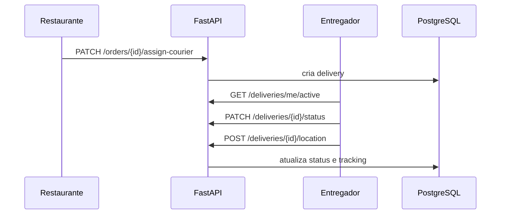

# Arquitetura da Solução

Este documento descreve a arquitetura do App de Entrega, as responsabilidades de cada
componente, os principais fluxos e as decisões que sustentam a solução. As decisões estão
registradas em [`adr/`](adr/).

## 1. Contexto e restrições

O sistema foi concebido para uma microempresa do setor de alimentação (açaiteria Combina Açaí),
com as seguintes restrições:

- Baixo custo de operação e de infraestrutura.
- Operação por uma equipe pequena, sem suporte técnico dedicado.
- Necessidade de acesso por navegador, sem instalação de aplicativo.
- Dados de clientes e pedidos tratados com confidencialidade.
- Implantação em nuvem com HTTPS e rotina de backup.
- Uso de APIs externas sem chave paga para geocodificação e rotas.

## 2. Visão de contexto



## 3. Visão de contêineres

| Contêiner | Tecnologia | Responsabilidade | Porta |
| --- | --- | --- | --- |
| `frontend` | Next.js 14 / Node 20 | Interface, estado, consumo da API | 3000 (interna) |
| `backend` | FastAPI / Python 3.11 | Regras de negócio, autenticação, API REST | 8000 (interna) |
| `postgres` | PostgreSQL 16 | Persistência relacional | 5432 (rede interna) |
| Nginx (host) | Nginx | Terminação TLS, proxy reverso | 80/443 |
| Cloudflare | CDN/WAF | Proxy laranja, DNS e proteção | 443 |

No ambiente publicado, apenas o Nginx expõe portas no host. O front-end e o back-end são
vinculados ao loopback (`127.0.0.1:3100` e `127.0.0.1:8100`) e o PostgreSQL não publica porta.

## 4. Componentes do back-end

```text
app/
├── api/
│   ├── deps.py          # Dependências de autenticação e autorização
│   └── v1/routes/       # Endpoints REST por domínio
├── core/                # Configuração e segurança (JWT, bcrypt)
├── db/                  # Sessão e base declarativa
├── models/              # Entidades SQLAlchemy
├── schemas/             # Contratos Pydantic
└── services/            # Regras de negócio e integrações
```

- **Rotas** validam entrada, aplicam dependências de autenticação/perfil e delegam para serviços.
- **Serviços** concentram regras de negócio, acesso ao banco e integrações externas.
- **Modelos** representam o esquema relacional; **schemas** definem contratos de entrada/saída.
- **Segurança** implementa hash de senhas, emissão/validação de JWT e RBAC.
- **Geolocalização** encapsula Nominatim e OSRM, com cache e fallback.

## 5. Componentes do front-end

```text
app/
├── page.tsx                 # Vitrine
├── restaurants/[id]/        # Cardápio
├── cart/                    # Carrinho, endereço e rota
├── orders/                  # Histórico do cliente
├── owner/                   # Painel do restaurante
├── courier/                 # Painel do entregador
├── login/ e register/       # Autenticação
└── layout.tsx               # Layout, metadados e acessibilidade
components/
├── header.tsx               # Navegação
├── delivery-route-map.tsx   # Busca de rota e resumo
└── route-map-canvas.tsx     # Mapa Leaflet (client-side)
lib/
├── api.ts                   # Cliente Axios
└── types.ts                 # Tipos compartilhados
store/
├── auth.ts                  # Token e usuário
└── cart.ts                  # Carrinho persistido
```

O mapa é carregado dinamicamente com `ssr: false`, pois o Leaflet depende do DOM. A API é
consumida por um cliente Axios com `baseURL` configurável.

## 6. Fluxos principais

### 6.1 Login



### 6.2 Pedido com rota



### 6.3 Entrega



## 7. Modelo de dados

O modelo relacional e o dicionário de dados estão em [`data-model.md`](data-model.md). As
principais relações são:

- `users` 1:N `addresses`, `orders`, `restaurants` (como dono) e `deliveries` (como entregador).
- `restaurants` 1:N `categories`, `products` e `orders`.
- `orders` 1:N `order_items`, 1:1 `payments` e 1:1 `deliveries`.
- `deliveries` 1:N `delivery_tracking`.
- `cart_items` associa usuário e produto.

## 8. Requisitos não funcionais

| Requisito | Implementação |
| --- | --- |
| Segurança | JWT, bcrypt, RBAC, CORS restrito, segredos fora do repositório |
| Desempenho | Índices por chaves estrangeiras, cache de geocodificação/rotas, build otimizado |
| Disponibilidade | Docker Compose com `restart: unless-stopped`, healthcheck do PostgreSQL |
| Manutenibilidade | Separação em camadas, tipagem, lint, testes e documentação |
| Acessibilidade | HTML semântico, ARIA, foco, `prefers-reduced-motion`, auditoria axe |
| Observabilidade | Logs do Uvicorn/Nginx e verificação de saúde da API |
| Portabilidade | Docker, variáveis de ambiente e migrations versionadas |

## 9. Decisões e trade-offs

| Decisão | Alternativas | Justificativa |
| --- | --- | --- |
| FastAPI + Next.js | Django, Flask, Rails | Tipagem, OpenAPI automático, ecossistema React e produtividade |
| PostgreSQL + Alembic | SQLite, MySQL | Integridade relacional, recursos avançados e migrations versionadas |
| OSM + Nominatim + OSRM | Google Maps, Mapbox | Custo zero, sem chave e aderência ao MVP; trade-off de SLA comunitário |
| Docker Compose + Nginx | Kubernetes, PaaS | Simplicidade operacional e custo compatível com a empresa base |
| JWT stateless | Sessão em servidor | Simplicidade para API REST e múltiplos clientes |

## 10. Limitações arquiteturais

- As instâncias públicas de Nominatim/OSRM não oferecem SLA; há cache e fallback.
- O rastreamento de entrega é baseado em pontos enviados manualmente, sem streaming em tempo real.
- Não há gateway de pagamento nem notificações push.
- A integração com o CRM do PI1 é uma evolução planejada.

## 11. Evolução

- Substituir o fallback por um provedor com SLA ou OSRM self-hosted.
- Adicionar fila para notificações e processamento assíncrono.
- Introduzir observabilidade com métricas e tracing.
- Integrar pagamentos e o CRM do PI1.
