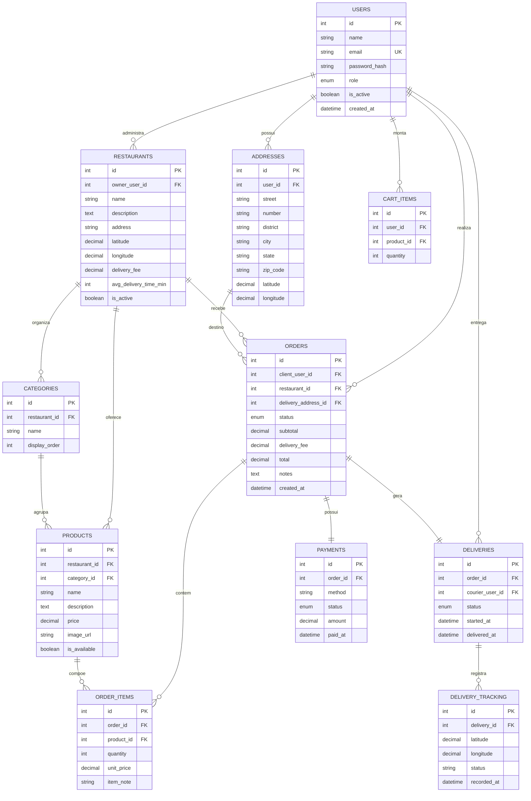

# Modelo de Dados

O banco é relacional, implementado em PostgreSQL 16 e versionado com Alembic. O modelo foi
projetado para preservar integridade referencial, evitar duplicidade e permitir a evolução do
sistema sem perda de dados.

## 1. Diagrama Entidade-Relacionamento



> O diagrama em imagem também está disponível em [`images/data-model.png`](images/data-model.png).

## 2. Dicionário de dados

### `users`
| Coluna | Tipo | Restrições | Descrição |
| --- | --- | --- | --- |
| `id` | serial | PK | Identificador do usuário |
| `name` | varchar(120) | NOT NULL | Nome |
| `email` | varchar(255) | UNIQUE, NOT NULL | Login |
| `password_hash` | varchar(255) | NOT NULL | Hash bcrypt |
| `role` | enum | NOT NULL | `cliente`, `dono_restaurante`, `entregador`, `admin` |
| `is_active` | boolean | default true | Ativação da conta |
| `created_at` | timestamptz | default now | Criação |

### `addresses`
| Coluna | Tipo | Restrições | Descrição |
| --- | --- | --- | --- |
| `id` | serial | PK | Identificador |
| `user_id` | int | FK → users | Proprietário |
| `street`, `number`, `district`, `city`, `state`, `zip_code` | varchar | NOT NULL | Endereço |
| `complement`, `reference` | varchar | NULL | Complemento/referência |
| `latitude`, `longitude` | numeric(10,7) | NULL | Coordenadas geocodificadas |

### `restaurants`
| Coluna | Tipo | Restrições | Descrição |
| --- | --- | --- | --- |
| `id` | serial | PK | Identificador |
| `owner_user_id` | int | FK → users | Dono |
| `name` | varchar(140) | NOT NULL | Nome |
| `description` | text | NULL | Descrição |
| `address` | varchar(255) | NULL | Endereço textual |
| `latitude`, `longitude` | numeric(10,7) | NULL | Coordenadas |
| `delivery_fee` | numeric(10,2) | default 0 | Taxa de entrega |
| `avg_delivery_time_min` | int | default 40 | Tempo médio |
| `is_active` | boolean | default true | Visibilidade |

### `categories` e `products`
| Tabela | Colunas principais | Regras |
| --- | --- | --- |
| `categories` | `id`, `restaurant_id`, `name`, `display_order` | Categoria pertence a um restaurante |
| `products` | `id`, `restaurant_id`, `category_id`, `name`, `description`, `price`, `image_url`, `is_available` | Produto pode ter categoria nula; preço obrigatório |

### `orders` e `order_items`
| Tabela | Colunas principais | Regras |
| --- | --- | --- |
| `orders` | `id`, `client_user_id`, `restaurant_id`, `delivery_address_id`, `status`, `subtotal`, `delivery_fee`, `total`, `notes`, `created_at` | Endereço e restaurante obrigatórios; totais persistidos |
| `order_items` | `id`, `order_id`, `product_id`, `quantity`, `unit_price`, `item_note` | Preço unitário congelado no momento do pedido |

### `payments`, `deliveries` e `delivery_tracking`
| Tabela | Colunas principais | Regras |
| --- | --- | --- |
| `payments` | `id`, `order_id`, `method`, `status`, `amount`, `paid_at` | 1:1 com pedido |
| `deliveries` | `id`, `order_id` (UNIQUE), `courier_user_id`, `status`, `started_at`, `delivered_at` | Uma entrega por pedido |
| `delivery_tracking` | `id`, `delivery_id`, `latitude`, `longitude`, `status`, `recorded_at` | Histórico de posições |

### `cart_items`
| Coluna | Tipo | Restrições | Descrição |
| --- | --- | --- | --- |
| `id` | serial | PK | Identificador |
| `user_id` | int | FK → users | Dono do carrinho |
| `product_id` | int | FK → products | Produto |
| `quantity` | int | default 1 | Quantidade |

> O carrinho do front-end é persistido no navegador (Zustand + `localStorage`); a tabela
> `cart_items` permanece como legado do contrato inicial da API.

## 3. Integridade e regras de negócio

- Chaves estrangeiras impedem pedidos sem cliente, restaurante ou endereço válido.
- `deliveries.order_id` é único: cada pedido tem no máximo uma entrega.
- `order_items.unit_price` preserva o preço praticado no momento da compra.
- Totais (`subtotal`, `delivery_fee`, `total`) são calculados no back-end.
- Status são enums persistidos como tipos do PostgreSQL.
- Coordenadas são validadas na API (`-90..90`, `-180..180`).
- Exclusões de endereço/produto são bloqueadas pela integridade referencial quando há histórico.

## 4. Índices e desempenho

- Chaves primárias e estrangeiras possuem índices automáticos no PostgreSQL.
- `users.email` é único.
- `deliveries.order_id` é único.
- Consultas de cardápio filtram por `restaurant_id` e `is_available`.
- Consultas de entregas ativas filtram por `courier_user_id` e status.

## 5. Migrations

| Revisão | Descrição |
| --- | --- |
| `0001_initial` | Criação do esquema inicial, enums e tabelas |
| `0002_geo_coordinates` | Coordenadas em endereços/restaurantes e endereço textual do restaurante |

```bash
cd backend
alembic upgrade head
alembic history
```
